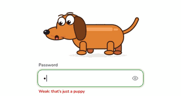

<p align="center"></p>

# Creative Login

**Playful characters that react while you log in.**

<p align="center">
  
</p>

Animated characters for login and password forms, built with React and SVG.
Each character reacts to what the user does:

| Interaction            | Reaction                                                     |
| ---------------------- | ------------------------------------------------------------ |
| Password gets stronger | Character-specific (see below), driven by `stretch` 0 → 1    |
| Typing                 | Eyes follow the text, tiny squash on each keystroke          |
| Mouse moves            | Eyes follow the pointer                                      |
| Password shown         | Closes its eyes and blushes (`shy`)                          |
| Login fails            | Shakes, squints and sweats (`error`)                         |
| Login succeeds         | Happy hop + themed emoji confetti (`happy`)                  |
| No activity for 15 s   | Falls asleep, "z z Z" (`sleep`)                              |

## Characters

| Character            | What strength does                                          |
| -------------------- | ----------------------------------------------------------- |
| 🐘 Perahera elephant | Raises its trunk; Perahera lamps light up one by one        |
| 🦚 Peacock           | Tail fans open                                              |
| 🛺 Tuk-tuk           | Stretches into a limousine, wheels spin, exhaust puffs      |
| 🐆 Yala leopard      | Rosettes pop in; tail rises                                 |
| 🐒 Toque macaque     | Climbs a coconut tree and grabs a king coconut (thambili)   |
| 🍵 Kade plain tea    | Glass fills with tea, bubbles, then steams                  |

## Use just one character (easiest way)

1. Run the app and open the gallery: `npm run dev` → <http://localhost:5173/#/gallery>
   (or click "Get a character" on the home page).
2. Play with the strength slider and moods.
3. Click **Copy code** or **Download .tsx**. You get **one self-contained file**:
   no CSS files, no extra packages, only React.
4. Drop it into your project and use it:

```tsx
import { Macaque } from './Macaque'

<Macaque
  stretch={passwordStrength} // 0..1
  mood="watch"               // idle | watch | shy | error | happy | sleep
  look={{ x: 0, y: 1 }}      // eye direction, each axis -1..1
/>
```

All props are optional. The SVG is decorative (`aria-hidden`) and respects
`prefers-reduced-motion`.

## Run the demo

```bash
npm install
npm run dev      # start dev server
npm run build    # type-check + production build
npm run lint     # oxlint
```

Pages:

- `#/` home page: what Creative Login is for, with a live demo
- `#/login` full login page demo
- `#/gallery` character gallery: play with each character and copy its code

Login is a frontend-only placeholder: replace `handleLogin` in `src/App.tsx`
with your real authentication call (throw an `Error` to show its message).

## Project structure

```
src/
  characters/          one file per character + core.tsx (shared eyes, moods, CSS)
    registry.ts        names, emoji, strength messages, confetti per character
  components/          TextField, CharacterPicker, Burst (confetti)
  features/auth/       LoginPage + validation / password strength
  gallery/             character gallery + single-file code builder
```

## Add a new character

1. Create `src/characters/MyCharacter.tsx`. Copy an existing character as a template.
   Use the shared pieces from `./core` (`CharacterSvg`, `Eye`, `Blush`, `Sweat`, `Zzz`)
   and keep the import from `./core` on **one line** (the gallery's code builder relies on it).
2. Put its CSS in the `CSS` string. Prefix every class and keyframe with
   `lc-<name>-` so characters never clash.
3. Drive the animation with the `--stretch` CSS variable (0..1) and the
   `data-mood` / `data-full` attributes on the root.
4. Register it in `src/characters/registry.ts`.

Contributions of more characters are very welcome!

## Credits

- Characters, mood system, gallery and website by **Risahd**.
- The idea of a character that stretches with password strength was inspired by a design seen online.
  <!-- TODO: add the original creator's name and a link here. -->

## Contributing

New characters are very welcome. See [CONTRIBUTING.md](CONTRIBUTING.md).

## License

[MIT](LICENSE) © 2026 Risahd. You're free to use, change and share it, including in
commercial projects, as long as you keep the copyright notice.
